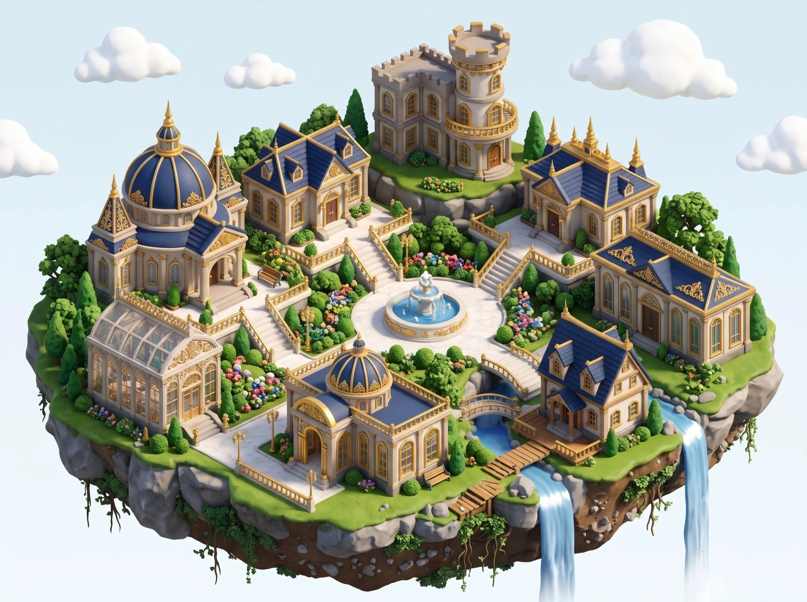

文／無痕美學診所 曾小米

無痕美學島升級了。

逛過舊版的人，打開應該會愣一下：「咦，這是同一座島嗎？」

先不要往下看。打開島逛一圈，數數看你發現了幾個不同，再回來對答案。

👉 [先去島上找找看](https://blog.wuhenclinic.tw/island/)

---

## 對答案：這次有六個不同

### 1. 小島長大了，還浮上了天空
舊版是一座平面的小島，升級版變成深藍金色的宮廷風浮島，底下有岩壁和兩道瀑布。八棟建築就是診所的八個空間：漂浮大門、大廳、諮詢區、治療室、恢復室、化妝間、院長辦公室、貓咖區。

### 2. 點房子，會「走進去」
以前點建築是跳出一張說明卡。現在點牌子，畫面會切進那個房間，大理石大廳、治療床、院長的書房都看得到。

### 3. 員工會跟你說話
護理師、美容師、院長和貓店員都換成了新造型，就在房間裡等你。他們會說說這個空間在做什麼、療程後回家要注意什麼。美編小進偶爾會從某個房間冒出來，說一句土味情話。

### 4. 櫃台的神秘店員還在
大廳櫃台後面站著一個黑色剪影。說出她的名字或職稱就算猜中，猜錯會給提示，猜中她會告訴你一個小秘密。

### 5. 島會跟著時間換樣子
清晨是淡紫粉色的天空，白天陽光明亮，黃昏亮起燈，晚上換成星空。聖誕節前，整座島還會積雪，廣場立起一棵大聖誕樹。

### 6. 隔壁多了一座森林島
主島逛完，可以去隔壁的森林島。那裡有 IG、FB 小屋、整理衛教文章的森林書屋、杜克勞咖啡屋，還有一台天氣風車：扇葉會照台北當下的風速轉動，點進去能看今天的紫外線、濕度和空氣品質，護理師和美容師會依天氣提醒你今天怎麼保養。

---

## 你找到幾個？

六個全中的話，歡迎到我們的 IG 或 FB 留言告訴我們。如果你還找到第七個，也一起說說看。

不用下載 App，手機打開就能逛。來診所之前，或是在等候的空檔，都歡迎上島走走。

👉 [前往無痕美學島](https://blog.wuhenclinic.tw/island/)

---

*本站為衛教資訊，所有療程需經醫師面診評估，效果因個人膚況而異。*
